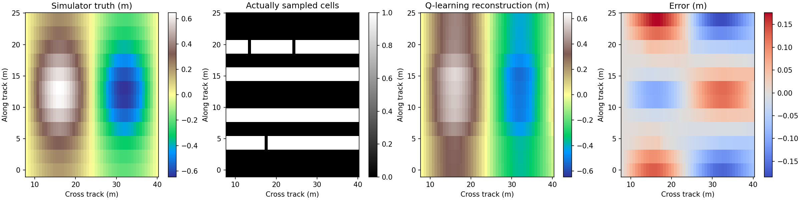

# IC 笔记 · 黑铁篇

数字 IC 学习笔记、交互案例与实验代码，使用 MkDocs Material 发布。

[在线笔记](https://superiorlqf.github.io/IC-Notes_Black-Iron-Series/) · [经典案例](https://superiorlqf.github.io/IC-Notes_Black-Iron-Series/classic_cases/)

## 侧扫声呐地形重建：已完成的工作

已新增独立目录 [sonar_terrain/](sonar_terrain/README.md)，实现从物理重建、真实数据读取到模拟采样与误差评估的实验。

**文章：[侧扫声呐地形重建：模拟采集与强化学习采样实验](https://superiorlqf.github.io/IC-Notes_Black-Iron-Series/classic_cases/sonar_reconstruction/)**

[文章 Markdown 源文](docs/classic_cases/sonar_reconstruction.md) · [模拟实验说明](sonar_terrain/simulation/README.md)

| 工作 | 内容与入口 |
| --- | --- |
| 物理重建 | [强度到坡度、稀疏积分、相对高程导出](sonar_terrain/reconstruct.py)，附推导、合成示例和测试 |
| 真实数据 | [StarFish 原始 XTF 片段](sonar_terrain/data/real/opensidescan/README.md)，439 个 ping，含高度和部分有效 GPS；保留来源、许可及校验值 |
| 实测预览 | [原始回波](sonar_terrain/examples/real_starfish/raw_all_pings.png)、[左舷](sonar_terrain/examples/real_starfish/port/surface.png)、[右舷](sonar_terrain/examples/real_starfish/starboard/surface.png)，标明经验校正条件 |
| 模拟采集 | [12 × 48 网格环境](sonar_terrain/simulation/experiment.py)，每次选择一行采集，只向策略提供已采集数据 |
| 强化学习 | 表格 Q-learning 优化 4 次采样的位置，训练奖励来自重建误差下降，无 GPU 或大模型 |
| 独立评估 | [完整指标](sonar_terrain/simulation/results/metrics.json)、[逐步动作与奖励](sonar_terrain/simulation/results/example_traces.json)，包含均匀/随机/全采样对照及模型不匹配测试 |



### 当前实验结论

在 12 个独立测试地形上，各策略的全图 RMSE 均值如下，单位 m：

| 策略 | 采样次数 | 同模型、噪声与缺测 | 几何和反射率不匹配 |
| --- | --- | --- | --- |
| 均匀 | 4 | 0.04677 | 0.08672 |
| 随机 | 4 | 0.07942 | 0.11103 |
| Q-learning | 4 | 0.06082 | 0.09954 |
| 全部采样 | 12 | 0.02221 | 0.07702 |

本次 Q-learning 优于随机，但未超过均匀采样。全采样使用三倍预算，仅作参考。上述数字都是模拟精度；真实 XTF 缺少完整辐射标定与配对测深真值，其探索性预览不代表已验证的海底高程。

### 复现实验

```bash
python -m pip install -r sonar_terrain/requirements.txt
python sonar_terrain/simulation/experiment.py \
  --output sonar_terrain/outputs/simulation --episodes 120 --test-count 12
python -m unittest discover -s sonar_terrain/tests -v
```

默认实验在当前云 CPU 上约 19 秒。原始 XTF 测试需要可选依赖 `sonar_terrain/requirements-xtf.txt`；未安装时该项测试跳过。算法、假设、奖励公式和评估范围见正式文章。

## 笔记与工具入口

- [RC 滤波器基础与公式推导](docs/rc_filters.md)
- [VLD/RDY 握手与流水仲裁案例](docs/classic_cases/index.md)
- [DigiWave 波形编辑器](https://superiorlqf.github.io/IC-Notes_Black-Iron-Series/digiwave/)
- [MkDocs 导航配置](mkdocs.yml)

## 本地构建笔记

```bash
mkdocs serve
# 或构建静态站点
mkdocs build --strict
```

需要安装仓库配置所用的 MkDocs Material、Markdown 数学扩展等依赖；声呐 Python 依赖与网站构建依赖相互独立。
