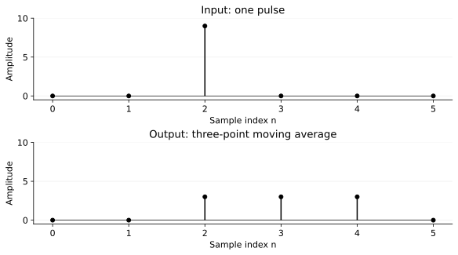
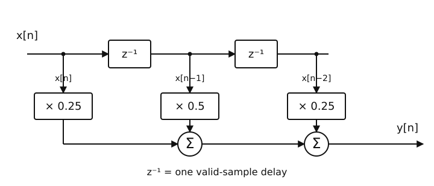
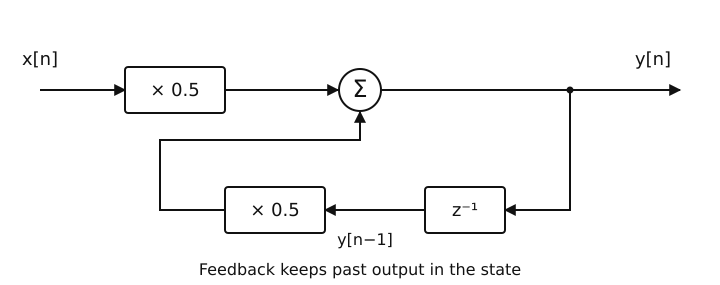
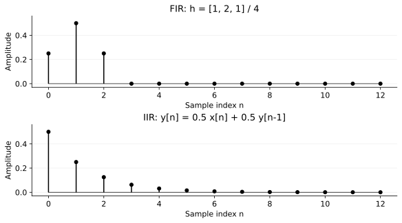
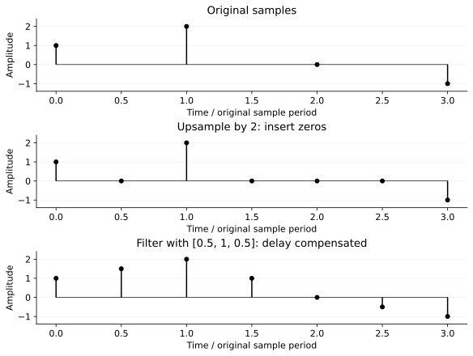
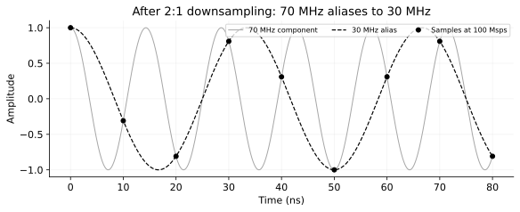
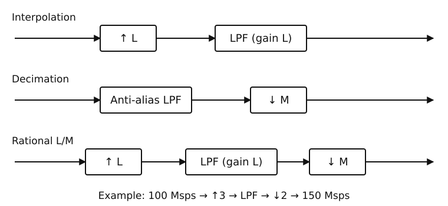
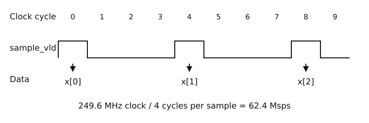

# 数字滤波器入门：FIR、IIR 与 SFC

本章接续 [RC 滤波器基础](rc_filters.md)，从采样序列开始理解数字滤波器，再联系通信芯片中的采样率转换和 RTL 实现。

## 1. 数字滤波器在处理什么

模拟滤波器处理连续信号；数字滤波器处理 ADC 采样得到的序列：

$$
x[0],\ x[1],\ x[2],\ \ldots
$$

若采样率为 \(f_s=1000\ \mathrm{Hz}\)，相邻采样之间的间隔为：

$$
T_s=\frac{1}{f_s}=1\ \mathrm{ms}.
$$

数字滤波器将输入序列映射为输出序列 \(y[n]\)，改变不同频率成分的幅度，通常也改变相位或时延。

### 1.1 三点平均滤波器

$$
\boxed{y[n]=\frac{x[n]+x[n-1]+x[n-2]}{3}}
$$

输入一个孤立脉冲，假设起始历史为零：

| 采样序号 | 0 | 1 | 2 | 3 | 4 | 5 |
| --- | ---: | ---: | ---: | ---: | ---: | ---: |
| 输入 | 0 | 0 | 9 | 0 | 0 | 0 |
| 输出 | 0 | 0 | 3 | 3 | 3 | 0 |

[](img/digital_filters/moving_average.svg)

图中输入的 9 被分散为连续三个 3，峰值降低，但影响持续时间变长。

单个突变被分散到三个采样时刻。这是最简单的低通滤波器之一：它倾向于保留缓慢变化、削弱快速变化，但并不会把所有高频成分都彻底消除。

## 2. FIR：有限冲激响应

FIR（Finite Impulse Response）的特点是：**当前输出只依赖当前及过去的输入，没有输出反馈**。

$$
\boxed{y[n]=\sum_{k=0}^{N-1}h[k]x[n-k]}
$$

其中 \(N\) 是 tap 数，\(h[k]\) 是滤波器系数。

以 3-tap FIR 为例：

$$
\boxed{y[n]=0.25x[n]+0.5x[n-1]+0.25x[n-2]}
$$

它的硬件结构是：两个采样延迟寄存器、三路系数乘法，以及一组加法逻辑。系数为 \(1/4,1/2,1/4\) 时，可以通过移位和加法实现常数乘法。

[](img/digital_filters/fir_structure.svg)

每个 \(z^{-1}\) 保存前一个有效样本；三路分别加权，再相加得到输出。

### 2.1 为什么它能滤除高频

不做傅里叶变换，也可以先直观看到它的频率选择性。

**恒定输入**：输入一直为 4，则稳态输出为：

$$
y[n]=(0.25+0.5+0.25)\times4=4.
$$

**逐采样正负交替的输入**：输入为 \(\ldots,4,-4,4,-4,\ldots\)，则：

$$
y[n]=0.25(4)+0.5(-4)+0.25(4)=0.
$$

因此该 FIR 完全保留直流，却消除了奈奎斯特频率 \(f_s/2\) 处的交替分量。其他频率的衰减程度还需要看完整频率响应。

### 2.2 FIR 名称的来源

单位冲激输入指 \(x[0]=1\)，其余采样为零。上面的 FIR 输出：

$$
y=[0.25,\ 0.5,\ 0.25,\ 0,\ 0,\ldots].
$$

脉冲消失后，经过有限个采样输出就严格归零，所以叫“有限冲激响应”。

FIR 的工程特征：

- 有限系数的非递归 FIR 是 BIBO 稳定的；
- 使用合适的对称系数，可获得严格线性相位；
- 复杂的频率指标往往需要更多 tap，消耗更多乘加资源；
- 没有输出反馈，因此加法树打拍和流水线通常比较容易。

## 3. IIR：无限冲激响应

IIR（Infinite Impulse Response）与 FIR 的关键区别是：**输出计算使用过去的输出值，存在反馈**。

一个简单的一阶 IIR：

$$
\boxed{y[n]=0.5x[n]+0.5y[n-1]}
$$

[](img/digital_filters/iir_structure.svg)

输出经一个采样延迟后反馈，与当前输入一起计算下一次输出。

初始状态为零，输入单位冲激：

| 采样序号 | 0 | 1 | 2 | 3 | 4 |
| --- | ---: | ---: | ---: | ---: | ---: |
| 输入 | 1 | 0 | 0 | 0 | 0 |
| 输出 | 0.5 | 0.25 | 0.125 | 0.0625 | 0.03125 |

每次输出都是前一次的一半，在精确数学模型中无限衰减而不会在有限采样内归零。

[](img/digital_filters/impulse_comparison.svg)

FIR 在第三个非零输出后归零；IIR 的尾部不断减半，图中只画出前 13 个样本。

常见的一阶平滑器：

$$
\boxed{y[n]=\alpha x[n]+(1-\alpha)y[n-1]},\quad 0<\alpha\le1
$$

\(\alpha\) 较小，输出变化较慢；\(\alpha\) 较大，输出更快跟随输入。这种指数记忆和 RC 低通的动态响应有相似之处。

IIR 通常能以较少系数达到某些较陡的幅频指标，不过必须关注反馈导致的稳定性、系数量化和定点溢出。IIR 并非天然稳定。

### 3.1 FIR 与 IIR 对比

| 属性 | FIR | IIR |
| --- | --- | --- |
| 过去的输入 | 使用 | 通常使用 |
| 过去的输出反馈 | 无 | 有 |
| 单位冲激响应 | 有限长 | 通常无限衰减 |
| 线性相位 | 对称系数下容易实现 | 通常较困难 |
| 稳定性 | 有限系数 FIR 天然稳定 | 需要单独检查 |
| RTL 重点 | tap 数、乘加树、流水 | 反馈路径、量化、稳定性 |

## 4. SFC：采样率转换器

这里 SFC 按 Sample Frequency Converter（采样频率转换器）理解；通用资料中也常称 SRC（Sample Rate Converter）。

**FIR、IIR 是滤波器类型；SFC 是改变采样率的功能模块。** SFC 内部可以用 FIR 等滤波结构。

例如：

| 输入采样率 | 输出采样率 | 功能 |
| --- | --- | --- |
| 100 Msps | 200 Msps | 2 倍插值 |
| 200 Msps | 100 Msps | 2 倍抽取 |
| 100 Msps | 150 Msps | 分数倍采样率转换 |

### 4.1 插值：为什么不能简单复制数据

100 Msps 变成 200 Msps，意味着相同时间内需要输出两倍数量的样本。简单把每个数据重复两次只能改变数量，通常无法提供理想的频谱。

一种标准做法是：

1. 在相邻输入点之间插入 \(L-1\) 个零；
2. 使用低通插值滤波器求出合理的新采样值，并抑制插零产生的频谱镜像。

这里需要按插值倍数合理设置滤波器增益，不能把“插零后直接输出”当作完整插值。

[](img/digital_filters/interpolation.svg)

图中采用增益为 2 的简单插值 FIR \([0.5,1,0.5]\)，并补偿一个高速样本的延迟以对齐展示。插零点经过滤波后变成相邻原始样本的中间值；这只是线性插值示例，不代表理想的镜像抑制。

### 4.2 抽取：为什么不能直接丢点

200 Msps 降为 100 Msps 时，奈奎斯特频率从 100 MHz 降至 50 MHz。

如果原信号中有超过 50 MHz 的频率成分，直接隔点取数可能产生**混叠（Aliasing）**：不同的原始频率折叠到同一输出频率，之后无法区分。

因此，典型流程是：**先抗混叠低通，再每隔 \(M\) 个采样取一个**。

[](img/digital_filters/aliasing.svg)

以原来的 200 Msps 输入为例，70 MHz 分量可以被表示；若直接抽取到 100 Msps，它与 30 MHz 余弦落在相同采样点上，无法区分。抗混叠滤波要在抽取之前完成。

### 4.3 分数倍转换

插值倍数为 \(L\)，抽取倍数为 \(M\)：

$$
\boxed{f_{\mathrm{out}}=f_{\mathrm{in}}\frac{L}{M}}
$$

例如：

$$
100\ \mathrm{Msps}\times\frac{3}{2}=150\ \mathrm{Msps}.
$$

[](img/digital_filters/rate_conversion.svg)

插值先插零再低通，抽取先低通再取样。分数倍转换中的低通同时抑制插值镜像和抽取混叠，并按插值倍数设置增益。

实际芯片里可以使用多相 FIR（Polyphase FIR），避免所有乘加都按插值后的高速时钟工作。具体吞吐率和时钟频率由硬件架构决定。

## 5. 采样率不等于时钟频率

对 RTL 工程师，必须区分：

- **时钟频率**：寄存器每秒经历多少个时钟周期。
- **采样率**：每秒有多少个有效样本。
- **有效采样标志**：指出哪些时钟周期真正包含样本。

例如 249.6 MHz 的模块时钟，每 4 个周期有一个有效样本：

$$
f_{\mathrm{sample}}=\frac{249.6}{4}=62.4\ \mathrm{Msps}.
$$

[](img/digital_filters/valid_sample_timing.svg)

只有 `sample_vld=1` 的周期接收新样本，历史寄存器也只在这些周期推进。其余周期不应当作额外的零值样本。

反过来，如果一个时钟周期并行处理两个采样，采样率也可能高于时钟频率。

FIR 里的 \(x[n-1]\) 指**前一个有效采样**，不一定是前一个时钟周期的输入信号。这会直接影响采样延迟寄存器何时更新。

## 6. 一个可综合的 3-tap FIR

采用系数 \([1,2,1]/4\)：

$$
y[n]=\frac{x[n]+2x[n-1]+x[n-2]}4.
$$

以下示例使用 16-bit 有符号样本、18-bit 加权和，只在有效采样到来时推进历史。移位是算术右移，尚未实现独立的舍入模式。

```systemverilog
module fir3_example (
    input  logic               clk,
    input  logic               rst_n,
    input  logic               sample_vld,
    input  logic signed [15:0] x_in,
    output logic               y_vld,
    output logic signed [15:0] y_out
);

    logic signed [15:0] x_d1, x_d2;
    logic signed [17:0] weighted_sum;

    always_comb begin
        weighted_sum =
            $signed({{2{x_in[15]}}, x_in})
          + ($signed({{2{x_d1[15]}}, x_d1}) <<< 1)
          + $signed({{2{x_d2[15]}}, x_d2});
    end

    always_ff @(posedge clk or negedge rst_n) begin
        if (!rst_n) begin
            x_d1  <= '0;
            x_d2  <= '0;
            y_out <= '0;
            y_vld <= 1'b0;
        end else begin
            y_vld <= 1'b0;
            if (sample_vld) begin
                x_d1  <= x_in;
                x_d2  <= x_d1;
                y_out <= weighted_sum >>> 2;
                y_vld <= 1'b1;
            end
        end
    end
endmodule
```

这里的重点是：

1. 历史寄存器在有效采样出现时才更新；
2. 非阻塞赋值使当前输入与此前两个有效样本参与同一次计算；
3. 18-bit 加权和容纳 16-bit 输入的四倍加权范围；
4. 实际项目还需明确启动阶段、舍入与饱和、流水时序和持续吞吐率。

## 7. 通信链路中的 SFC

多通道 MIMO 系统中，SFC 不只是让数据“变快或变慢”，还会影响采样时刻和通道间时延。

即使两个通道最终输出同一采样率，如果转换比例配置、滤波器状态、改配生效时刻不一致，也可能产生相位或时延差。因此工程上需检查：

- 采样率比例与配置更新的生效时刻；
- 输入输出有效采样节奏；
- 多通道滤波器状态及启动延迟；
- 时钟域接口及 CDC；
- 相干接收所需的通道间时序对齐。

某些 IP 使用 fratio 表示采样率相关参数，但其寄存器编码并无统一行业定义，**不能直接认定 fratio = L/M**，必须以具体模块规格为准。

## 8. 自测与下一节

1. 一阶表达式 \(y[n]=x[n]+0.5y[n-1]\) 为什么属于 IIR？
2. 240 MHz 时钟，每 3 个周期输入一个有效采样，采样率为多少？
3. 200 Msps 降成 100 Msps，为什么必须考虑抗混叠？
4. 为什么 3-tap FIR 的历史寄存器通常应按采样有效信号推进？

**答案**：① 使用历史输出反馈；② 80 Msps；③ 新奈奎斯特频率降低，原高频可能折叠；④ 公式中的 n 是有效样本序号，而非任意时钟周期。

**下一节**：[FIR 设计：频率、tap 数与参数选择](fir_design.md)，包含低通/高通频率响应、tap 估算、75-tap 设计算例和系数量化结果。
