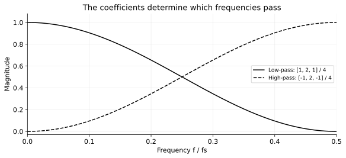
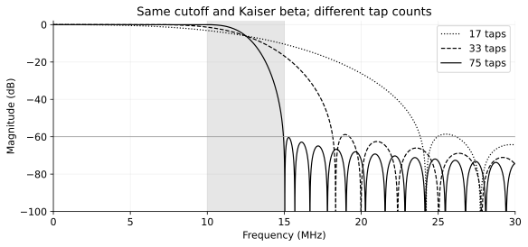
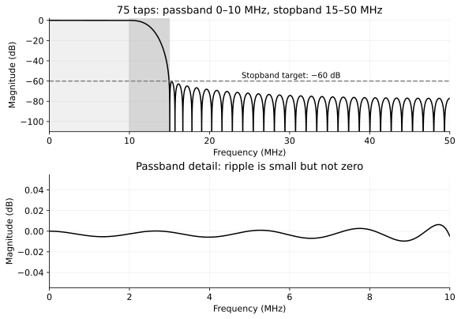
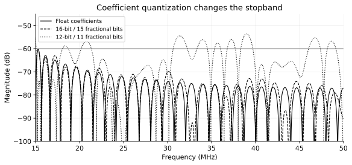

# FIR 设计：频率、tap 数与参数选择

本章接续[数字滤波器入门](digital_filters_intro.md)。设计 FIR 时，先确定**采样率、保留频段、抑制频段和衰减要求**，再选择 tap 数和系数，最后检查时延、定点精度及硬件吞吐率。

## 1. 核心参数

| 参数 | 含义 | 设计时的作用 |
| --- | --- | --- |
| \(f_s\) | 有效样本的采样率 | 决定数字频率对应多少 Hz，不是默认等于模块时钟 |
| \(f_p\) | 低通通带边缘 | 希望一直保留到哪个频率 |
| \(f_{\mathrm{stop}}\) | 低通阻带边缘 | 从哪个频率起必须压到指标以下 |
| \(\Delta f\) | 过渡带宽，低通中为 \(f_{\mathrm{stop}}-f_p\) | 越窄通常需要越多 tap |
| \(R_p\) | 通带纹波，dB | 通带内允许多大的幅度起伏 |
| \(A_s\) | 阻带衰减，dB | 不需要的频率至少压低多少 |
| \(N\) | tap 数，即系数个数 | 影响资源、过渡带和群时延 |
| \(B_c\) | 系数位宽 | 决定量化后的响应能否保持指标 |

**只说“做一个 10 MHz 低通”还不够确定 tap 数。** 必须知道采样率、从哪里开始要求抑制，以及需要抑制多少。

## 2. FIR 中的频率

连续正弦 \(x(t)=\cos(2\pi ft)\) 按 \(T_s=1/f_s\) 采样：

$$
x[n]=\cos\left(2\pi\frac{f}{f_s}n\right)=\cos(\Omega n),
\qquad \boxed{\Omega=2\pi\frac{f}{f_s}}.
$$

\(\Omega\) 是数字角频率，单位 rad/sample。对实系数 FIR，通常查看 \(0\) 到 \(f_s/2\) 的幅频响应。

| 写法 | 频率范围 | 100 Msps 下的 10 MHz |
| --- | --- | --- |
| 物理频率 \(f\) | \(0\sim f_s/2\) | 10 MHz |
| \(f/f_s\) | \(0\sim0.5\) | 0.1 |
| \(f/(f_s/2)\) | \(0\sim1\) | 0.2 |
| 数字角频率 \(\Omega\) | \(0\sim\pi\) | \(0.2\pi\) rad/sample |

不同工具使用的归一化方式可能相差一倍。使用 SciPy `firwin` 时，建议显式传入 `fs`，截止频率直接用 Hz，避免混淆。

如果系数固定，数字频率响应的形状固定；采样率翻倍，其对应的物理频率也翻倍。例如在 100 Msps 下约 10 MHz 的特征点，到 200 Msps 下就对应约 20 MHz。

## 3. 系数如何决定低通和高通

FIR 的差分方程为

$$
y[n]=\sum_{k=0}^{N-1}h[k]x[n-k].
$$

输入一个复指数 \(x[n]=e^{j\Omega n}\)：

$$
\begin{aligned}
y[n]
&=\sum_{k=0}^{N-1}h[k]e^{j\Omega(n-k)}\\
&=e^{j\Omega n}\underbrace{\sum_{k=0}^{N-1}h[k]e^{-j\Omega k}}_{H(e^{j\Omega})}.
\end{aligned}
$$

因此，**各个延迟分量在不同频率下以不同相位相加**，得到

$$
\boxed{H(e^{j\Omega})=\sum_{k=0}^{N-1}h[k]e^{-j\Omega k}}.
$$

\(\lvert H\rvert\) 决定幅度比，\(\arg H\) 决定相位变化。FIR 不是单独识别某个频率后将其删除，而是靠延迟、乘法与求和，让不同频率增强或抵消。

### 3.1 三点低通

取系数 \([1,2,1]/4\)：

$$
H_{\mathrm{LP}}(e^{j\Omega})
=\frac14+\frac12e^{-j\Omega}+\frac14e^{-j2\Omega}
=e^{-j\Omega}\cos^2(\Omega/2).
$$

所以

$$
\boxed{\lvert H_{\mathrm{LP}}\rvert=\cos^2(\pi f/f_s)}.
$$

直流增益为 1，\(f_s/2\) 处增益为 0。它是低通，但过渡很宽，不能因为叫低通就认为能满足任意窄带指标。

### 3.2 三点高通

将“延迟一个样本的原信号”减去低通输出：

$$
y_{\mathrm{HP}}[n]=x[n-1]-y_{\mathrm{LP}}[n].
$$

得到系数 \([-1,2,-1]/4\)，对应

$$
H_{\mathrm{HP}}(e^{j\Omega})=e^{-j\Omega}\sin^2(\Omega/2),
\qquad
\boxed{\lvert H_{\mathrm{HP}}\rvert=\sin^2(\pi f/f_s)}.
$$

[](img/fir_design/low_high_response.svg)

两种滤波器都是 3 taps，频率选择性却不同。**tap 数决定自由度，具体滤什么由系数决定。**

两个快速检查点是：

$$
H(0)=\sum_kh[k],\qquad H(\pi)=\sum_k(-1)^kh[k].
$$

单位增益低通通常满足系数和约为 1；高通应使系数和约为 0，从而去掉直流。但这些只是端点检查，不能替代整条响应曲线。

## 4. 低通与高通的频率指标

### 4.1 通带、过渡带与阻带

以采样率 100 Msps 的低通为例：

- 0～10 MHz 为通带，希望信号基本不变。
- 10～15 MHz 为过渡带，允许响应逐渐下降。
- 15～50 MHz 为阻带，要求至少衰减 60 dB。

低通的通带在低频，高通的通带在高频。高通指标的顺序相反：先给出低频阻带边缘，再给出更高的通带边缘。

| 类型 | 示例指标，\(f_s=100\) Msps | 主要用途 |
| --- | --- | --- |
| 低通 | 通带到 10 MHz，阻带从 15 MHz 开始 | 去除高频干扰、抽取前抗混叠 |
| 高通 | 阻带到 10 MHz，通带从 15 MHz 开始 | 抑制直流或低频漂移 |
| 带通 | 给出左右两侧的通带/阻带边缘 | 保留指定频段 |

若通信信号已经混频到零频，通常用低通保留基带；“去除直流”不是所有系统都需要的，高通也可能损伤靠近直流的有效信号。

### 4.2 截止频率不等于通带边缘

实际设计通常给出 \(f_p\) 和 \(f_{\mathrm{stop}}\)，而非一个理想的刀切频率。窗函数法常把设计截止频率放在过渡带中间：

$$
f_c\approx\frac{f_p+f_{\mathrm{stop}}}{2}.
$$

本例为 12.5 MHz。SciPy `firwin` 的 `cutoff` 采用约半幅点，也就是约 −6 dB；**不能沿用 RC 截止频率的 −3 dB 含义**，也不能把 `cutoff=10 MHz` 自动理解为通带一直平坦到 10 MHz。

### 4.3 纹波与衰减

幅频响应的 dB 表示为

$$
G_{\mathrm{dB}}(f)=20\log_{10}\lvert H(f)\rvert.
$$

60 dB 阻带衰减意味着幅度不大于通带标称幅度的 \(10^{-3}\)。本例将通带纹波定义为通带最大、最小幅度之比：

$$
R_p=20\log_{10}\frac{\max_{\mathrm{通带}}\lvert H\rvert}
{\min_{\mathrm{通带}}\lvert H\rvert}.
$$

不同工具也可能给出相对于 0 dB 的单边容差，填参数前需要确认其含义。

## 5. tap 数如何选择

### 5.1 tap 数、阶数与延迟

\(N\) 个系数对应 **N taps、N−1 阶**。例如 75 taps 是 74 阶，不是 75 阶。

对称系数的线性相位 FIR，群时延为

$$
\boxed{D=\frac{N-1}{2}\ \text{个样本}},\qquad
\boxed{t_D=\frac{N-1}{2f_s}}.
$$

75 taps 在 100 Msps 下的群时延为 37 个样本，即 370 ns。RTL 中额外的流水寄存器、串行计算、接口缓存延迟还要另算。

默认选奇数 tap 比较方便：对称中心位于整数样本上，低通和高通都容易设计。偶数 tap 也可用，但偶数长度的实对称 FIR 在 \(f_s/2\) 必有零点，不适合要求一直通过奈奎斯特频率的标准高通。

### 5.2 Kaiser 窗的估算

用 Kaiser 窗做一个起点，阶数可估算为

$$
\boxed{N-1\approx\frac{A-8}{2.285\Delta\Omega}},\qquad
\Delta\Omega=2\pi\frac{\Delta f}{f_s}.
$$

其中 \(A\) 来自较严格的通带/阻带误差要求。单位增益滤波器可先换算

$$
\delta_p=\frac{10^{R_p/20}-1}{10^{R_p/20}+1},\quad
\delta_s=10^{-A_s/20},\quad
A=-20\log_{10}\min(\delta_p,\delta_s).
$$

用这个近似可以直接看出：

| 改动 | tap 数的趋势 |
| --- | --- |
| 采样率固定，过渡带减半 | 大约翻倍 |
| 物理过渡带固定，采样率翻倍 | 大约翻倍 |
| 阻带衰减提高 | 增加 |
| 所有频率与采样率同比缩放 | 归一化指标不变，通常不需要改 tap |

[](img/fir_design/tap_tradeoff.svg)

**不要先指定“必须 32 taps”，再期待它满足任意频率要求。** 先按指标估算，再检查是否符合资源和延迟预算；不够时放宽过渡带或调整架构。

### 5.3 系数怎样得到

窗函数法先构造理想低通，再截取有限长度并加窗。令 \(D=(N-1)/2\)：

$$
h_{\mathrm{ideal}}[n]=\frac{2f_c}{f_s}
\operatorname{sinc}\!\left[\frac{2f_c}{f_s}(n-D)\right],
\qquad \operatorname{sinc}(u)=\frac{\sin(\pi u)}{\pi u}.
$$

乘上窗函数 \(w[n]\)，再按目标增益归一化，就得到有限个系数。窗函数控制截断造成的旁瓣，tap 数和窗参数一起决定过渡带、纹波与阻带。

| 设计方法 | 适合的起点 |
| --- | --- |
| Hamming 等固定窗 + `firwin` | 学习、快速构造，不需要精细控制每段误差 |
| Kaiser 窗 + `kaiserord` / `firwin` | 用衰减和过渡带估算 tap，参数较直观 |
| 等波纹设计 `remez` | 明确各频段边缘与权重，进一步优化资源 |

Kaiser 的 \(\beta\) 越大，通常旁瓣越低，但同样 tap 下过渡更宽；不要只提高 \(\beta\) 而忽略 tap 数。估算也不是最少 tap 的证明，需要看实际响应。

## 6. 完整低通设计算例

### 6.1 设计输入与结果

| 项目 | 数值 |
| --- | --- |
| 采样率 | 100 Msps |
| 通带边缘 | 10 MHz |
| 阻带边缘 | 15 MHz |
| 允许通带纹波 | 0.1 dB |
| 目标阻带衰减 | 60 dB |
| `firwin` 截止频率 | 12.5 MHz |
| Kaiser \(\beta\) | 5.65326 |
| 最终 tap 数 / 阶数 | 75 / 74 |
| 群时延 | 37 个样本，370 ns |

`kaiserord` 给出初始长度 74，取下一个奇数为 75。对最终系数使用 131073 个频率点检查：通带纹波约 **0.0160 dB**，阻带衰减约 **60.38 dB**，满足本例指标。

[](img/fir_design/design_specification.svg)

### 6.2 Python 实现

```python
import numpy as np
from scipy.signal import kaiserord, firwin, freqz

fs = 100e6
fp, fstop = 10e6, 15e6
rp, attenuation = 0.1, 60.0

delta_p = (10**(rp/20) - 1) / (10**(rp/20) + 1)
delta_s = 10**(-attenuation/20)
A = -20*np.log10(min(delta_p, delta_s))
N, beta = kaiserord(A, (fstop-fp)/(fs/2))
if N % 2 == 0:
    N += 1

for _ in range(100):
    h = firwin(N, (fp+fstop)/2, fs=fs, window=("kaiser", beta))
    f, H = freqz(h, worN=131073, fs=fs, include_nyquist=True)
    mag = np.abs(H)
    pb, sb = mag[f <= fp], mag[f >= fstop]
    actual_rp = 20*np.log10(pb.max()/pb.min())
    actual_as = -20*np.log10(sb.max())
    if actual_rp <= rp and actual_as >= attenuation:
        break
    N += 2
else:
    raise RuntimeError("未在搜索范围内找到满足指标的 tap 数")

print(N, beta, actual_rp, actual_as)
```

这是稠密频率网格检查；不能只查看截止处或某一个阻带零点，就认为整段阻带都达标。

### 6.3 改成高通

对于“低频阻带到 10 MHz、高频通带从 15 MHz 开始”的高通，可以用相同过渡带和奇数 tap 作为起点：

```python
N_hp = N
for _ in range(100):
    h_hp = firwin(N_hp, 12.5e6, fs=fs,
                  window=("kaiser", beta), pass_zero=False)
    f, H = freqz(h_hp, worN=131073, fs=fs, include_nyquist=True)
    mag = np.abs(H)
    pb, sb = mag[f >= 15e6], mag[f <= 10e6]
    if (20*np.log10(pb.max()/pb.min()) <= rp
            and -20*np.log10(sb.max()) >= attenuation):
        break
    N_hp += 2
else:
    raise RuntimeError("高通指标未满足")
```

检查时将阻带改为 `f <= 10e6`，通带改为 `f >= 15e6`；不能继续用低通的掩码计算指标。

本例高通直接使用 75 taps 时，阻带衰减只有约 **59.63 dB**，未达到 60 dB；保持相同窗参数、逐个检查奇数长度后，**81 taps** 得到约 **60.67 dB**，通带纹波约 **0.0161 dB**。因此不能把低通的 tap 数直接当作高通已经达标的结果。

另一种方法是对称低通的频谱反转：\(h_{\mathrm{HP}}[n]=\delta[n-D]-h_{\mathrm{LP}}[n]\)。中间系数用 1 减去原值，其余系数取负，再检查高通增益和指标。

## 7. 系数位宽与 RTL 资源

### 7.1 系数量化也会改变频率响应

75 个系数用有符号 16-bit、15 位小数表示：

$$
C[k]=\operatorname{round}(h[k]2^{15}),\qquad
h_q[k]=\frac{C[k]}{2^{15}}.
$$

使用原系数相同的频率网格，得到：

| 系数表示 | 通带纹波 | 阻带衰减 |
| --- | --- | --- |
| 浮点 | 0.0160 dB | 60.38 dB |
| 12-bit，11 位小数 | 0.0336 dB | 53.61 dB |
| 16-bit，15 位小数 | 0.0154 dB | 60.20 dB |
| 20-bit，19 位小数 | 0.0160 dB | 60.38 dB |

[](img/fir_design/coefficient_quantization.svg)

本例 12-bit 系数已经达不到 60 dB，16-bit 则仍满足，但余量很小。实际设计应留出余量，并验证乘积截位、累加、舍入和饱和后的完整定点实现；这里只评价了系数量化。

### 7.2 tap 不直接等于乘法器数量

75-tap 对称 FIR 有 \(h[k]=h[74-k]\)，可先将输入样本两两相加再乘同一系数，独立系数乘法从 75 路降到 38 路。

- 样本预加要增加位宽，不能把两个 16-bit 数仍按 16-bit 相加。
- 能否进一步复用乘法器，取决于模块时钟、样本速率、访存和流水安排。
- 如果每个样本只允许一个时钟周期，串行复用的余地很小；有多个周期预算才便于分时计算。

对 16-bit 输入、16-bit 系数，完整乘积为 32-bit。直接累加的保守位宽可取

$$
B_{\mathrm{acc}}=B_x+B_c+\lceil\log_2N\rceil
=16+16+7=39\ \mathrm{bit}.
$$

也可以按实际系数的绝对值和收紧范围：

$$
\lvert y[n]\rvert\le X_{\max}\sum_k\lvert h[k]\rvert.
$$

注意低通系数和为 1，并不代表 \(\sum\lvert h[k]\rvert=1\)；有负系数时，不能据此认定任意输入都不会出现峰值增大。

## 8. 参数确定流程

1. **确认采样率**：使用有效样本速率，确定滤波位于插值/抽取的哪一级。
2. **画出频段**：低通给通带边缘和阻带边缘；高通顺序相反。不要只给一个“截止频率”。
3. **给出容差**：允许多少通带纹波，需要多少阻带衰减，是否要求线性相位。
4. **估算并验证 tap**：先用 Kaiser 得到起点，再测量整段通带和阻带；需要时尝试等波纹设计。
5. **核算时延和资源**：群时延、DSP、历史缓存、每个样本的计算周期是否可接受。
6. **量化再检查**：系数转成目标位宽后重新测频响，再做完整定点波形验证。

若 tap 超预算，优先考虑放宽过渡带、降低衰减要求，或在满足抗混叠条件的前提下使用多级/多相结构。抽取前的抗混叠滤波不能省略，不能为了减少 tap 把已经发生的混叠留给后级补救。

## 9. 复现与系数下载

在仓库根目录运行：

```bash
python -m pip install numpy scipy matplotlib
python scripts/design_fir_example.py
```

[设计指标与实测报告](img/fir_design/design_report.json) · [75-tap 低通浮点与 16-bit 系数 CSV](img/fir_design/coefficients.csv) · [81-tap 高通浮点系数 CSV](img/fir_design/highpass_coefficients.csv) · [完整生成脚本](https://github.com/SuperiorLQF/IC-Notes_Black-Iron-Series/blob/main/scripts/design_fir_example.py)

参考：[SciPy firwin](https://docs.scipy.org/doc/scipy/reference/generated/scipy.signal.firwin.html)、[kaiserord](https://docs.scipy.org/doc/scipy/reference/generated/scipy.signal.kaiserord.html)、[freqz](https://docs.scipy.org/doc/scipy/reference/generated/scipy.signal.freqz.html)。
