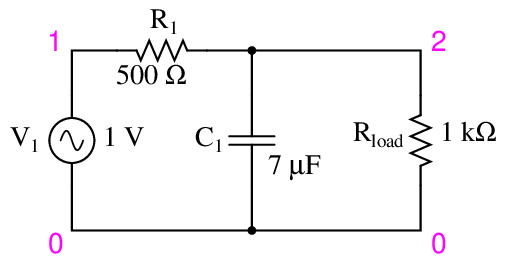
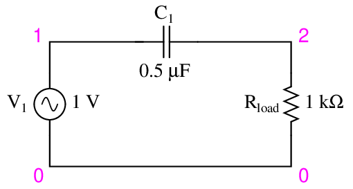

# 滤波器基础：RC 电路的时域与频域推导

RC 滤波器只有电阻、电容两个元件，却能把**元件方程、微分方程、复数分压、幅频响应和相位响应**串起来。本节先给出结论，再逐步说明结论从哪里来。

## 1. 核心结论与适用条件

以下首先假定：\(R>0\)、\(C>0\)，元件理想、线性且参数不变；输入由理想电压源提供，输出端没有额外负载，或测量仪器的输入阻抗足够高。

| 项目 | RC 低通 | RC 高通 |
| --- | --- | --- |
| 电路图 | { width="320" } | { width="320" } |
| 连接方式 | 电阻串联，电容接公共参考端，输出取电容两端 | 电容串联，电阻接公共参考端，输出取电阻两端 |
| 时间常数 | \(\tau=RC\) | \(\tau=RC\) |
| 零初始条件下的传递函数 | \(H_{\mathrm{LP}}(s)=\dfrac{1}{1+s\tau}\) | \(H_{\mathrm{HP}}(s)=\dfrac{s\tau}{1+s\tau}\) |
| 截止频率 | \(f_c=\dfrac{1}{2\pi RC}\) | \(f_c=\dfrac{1}{2\pi RC}\) |
| 直流稳态 | 输出等于输入 | 输出为零 |
| \(f=f_c\) 时的电压幅度比 | \(1/\sqrt{2}\approx0.7071\) | \(1/\sqrt{2}\approx0.7071\) |
| \(f=f_c\) 时的输出相位 | 滞后输入 \(45^\circ\) | 超前输入 \(45^\circ\) |

电路图取自公开教材 *Lessons in Electric Circuits*（[来源与许可](img/filters/SOURCES.md)）。两图均以节点 2 相对节点 0 的电压为输出。低通图中的额外负载 \(R_{\mathrm{load}}\) 在本表公式中视为空载；高通图中的 \(R_{\mathrm{load}}\) 就是公式里的 \(R\)。图示元件数值仅为教材示例。

!!! note "两个限定不能省略"
    传递函数定义的是**零初始条件**下的输入输出关系；有初始储能时，输出还包含初始条件引起的响应。截止频率的幅度门槛是**相对于通带增益**定义的；本表的理想电路通带增益为 1，所以恰好也是输入幅度的 70.7%。

本节用 \(v(t)\) 表示瞬时电压，\(\underline V\) 表示正弦稳态相量，\(V(s)\) 表示拉普拉斯变换。\(t\) 的单位为秒，\(f\) 为 Hz，\(\omega\) 为 rad/s，且

$$
\omega=2\pi f,\qquad j^2=-1.
$$

## 2. 元件方程与复阻抗推导

### 2.1 电阻、电容、电感的基本关系

采用被动符号约定，即电流流入元件电压的正端：

| 元件 | 时域关系 | 正弦稳态阻抗 |
| --- | --- | --- |
| 电阻 | \(v_R(t)=Ri_R(t)\) | \(Z_R=R\) |
| 电容 | \(i_C(t)=C\dfrac{\mathrm d v_C}{\mathrm dt}\) | \(Z_C=\dfrac{1}{j\omega C}=-\dfrac{j}{\omega C}\) |
| 电感 | \(v_L(t)=L\dfrac{\mathrm d i_L}{\mathrm dt}\) | \(Z_L=j\omega L\) |

复阻抗不是另一套物理规律，而是元件微分关系在**正弦稳态**下的简写。

以电容为例，写成复指数形式：

$$
v_C(t)=\operatorname{Re}\!\left\{\underline V_C e^{j\omega t}\right\}.
$$

代入电容方程，求导会带来一个 \(j\omega\)：

$$
\underline I_C=j\omega C\underline V_C
\quad\Longrightarrow\quad
\boxed{Z_C=\frac{\underline V_C}{\underline I_C}
=\frac{1}{j\omega C}}.
$$

因此

$$
\boxed{\lvert Z_C\rvert=\frac{1}{\omega C}=\frac{1}{2\pi fC}}.
$$

频率越低，电容阻抗的模越大；频率越高，阻抗的模越小。\(f=0\) 应按直流稳态或 \(f\to0\) 的极限理解，不能直接把 \(1/0\) 当成普通数代入计算。

### 2.2 阻抗与电抗的关系

把阻抗写成

$$
\boxed{Z=R+jX},
$$

其中 \(X\) 是带符号的电抗：

$$
X_L=\omega L,\qquad X_C=-\frac{1}{\omega C}.
$$

有些资料把“容抗”写成正的大小 \(1/(\omega C)\)，那时负号已经包含在 \(-j\) 中。需要先确认符号约定，避免重复添加或漏掉负号。

例如串联 RLC 的总阻抗为

$$
Z=R+j\left(\omega L-\frac{1}{\omega C}\right).
$$

**阻抗要按复数运算，不能把各阻抗的模直接相加后做分压。**

## 3. RC 电路拓扑与滤波类型

### 3.1 RC 低通：输出取电容两端

{ width="560" }

*图 1：公开教材中的 RC 低通电路原图。图中电源 \(V_1\) 为输入，节点 2 相对节点 0 的电压为输出。原图含额外负载 \(R_{\mathrm{load}}\)；第 4～10 节先令它趋于无穷大（空载），第 11 节再推导实际负载的影响。图中元件值是教材示例，与第 10 节算例不同。原图及许可见文末。*

低频时，\(\lvert Z_C\rvert\) 很大，串联电流较小，电阻上的压降较小，输出接近输入。高频时，\(\lvert Z_C\rvert\) 较小，输出节点更容易经电容连接到公共参考端，输出幅度减小。

这里的关键是**电阻与电容共同分压**。只说“高频都流进地了”不够准确：公共参考端不是电流消失的地方，电流仍通过电源构成回路。

### 3.2 RC 高通：输出取电阻两端

{ width="560" }

*图 2：公开教材中的 RC 高通电路原图。图中承担输出负载的电阻，对应本节高通模型里的 \(R\)；不要再把它当成额外并联负载重复计算。*

低频时，电容阻抗较大，串联电流较小，电阻上的电压也较小。高频时，电容阻抗较小，电阻上的电压接近输入。

“电容隔直通交”适合描述这种**串联电容**的直流隔离作用。含有电容的电路并不一定阻断直流：图 1 的理想低通在直流稳态下就有 \(v_{\mathrm{out}}=v_{\mathrm{in}}\)。

## 4. RC 低通的时域方程推导

输出端没有额外负载时，电阻电流等于电容电流。根据 KVL：

$$
v_{\mathrm{in}}(t)=v_R(t)+v_C(t).
$$

因为输出取电容两端，\(v_{\mathrm{out}}=v_C\)，又有

$$
v_R=Ri,\qquad i=C\frac{\mathrm d v_{\mathrm{out}}}{\mathrm dt},
$$

所以

$$
v_{\mathrm{in}}
=RC\frac{\mathrm d v_{\mathrm{out}}}{\mathrm dt}
+v_{\mathrm{out}}.
$$

定义时间常数

$$
\boxed{\tau=RC},
$$

就得到一阶微分方程

$$
\boxed{\tau\frac{\mathrm d v_{\mathrm{out}}}{\mathrm dt}
+v_{\mathrm{out}}=v_{\mathrm{in}}}.
$$

\(RC\) 的单位为 \(\Omega\cdot\mathrm F=\mathrm s\)。时间常数描述电路动态响应的时间尺度，不是“充满电所需的精确时间”。

## 5. RC 低通的阶跃响应

### 5.1 电容电压连续性与初始条件

假设 \(t=0\) 之后输入恒定为 \(U\)，电容原有电压为 \(V_0\)。对于有限幅度的电压阶跃以及非零串联电阻，电容电流不含理想冲激，因此

$$
v_C(0^+)=v_C(0^-)=V_0.
$$

原因可由电容方程直接看出：

$$
v_C(0^+)-v_C(0^-)
=\frac{1}{C}\lim_{\varepsilon\to0^+}
\int_{-\varepsilon}^{\varepsilon}i_C(t)\,\mathrm dt=0.
$$

“电容电压不能突变”隐含了**没有冲激电流**这个条件。理想模型若强加冲激电流，则需要另行处理，不能机械套用上式。

### 5.2 恒定输入下的通解

对 \(t>0\)，微分方程为

$$
\tau\frac{\mathrm d v_{\mathrm{out}}}{\mathrm dt}
+v_{\mathrm{out}}=U.
$$

令 \(w=v_{\mathrm{out}}-U\)，则

$$
\tau\frac{\mathrm dw}{\mathrm dt}+w=0.
$$

乘以积分因子 \(e^{t/\tau}\)：

$$
\frac{\mathrm d}{\mathrm dt}\left(w e^{t/\tau}\right)=0.
$$

因此 \(w e^{t/\tau}\) 是常数。由 \(w(0^+)=V_0-U\)，得到

$$
\boxed{v_{\mathrm{out}}(t)=U+(V_0-U)e^{-t/\tau},\qquad t\ge0}.
$$

这是应优先掌握的形式：**最终值 + 初值与最终值之差 × 衰减指数**。它同时涵盖充电、放电和带初始电压的情形。

### 5.3 0 V 至 5 V 阶跃响应算例

若 \(t<0\) 输入为 0，且电路已达到稳态，那么 \(V_0=0\)。于是

$$
v_{\mathrm{in}}(t)=
\begin{cases}
0,&t<0,\\
5\,\mathrm V,&t\ge0,
\end{cases}
$$

$$
\boxed{
v_{\mathrm{out}}(t)=
\begin{cases}
0,&t<0,\\
5\,\mathrm V\left(1-e^{-t/RC}\right),&t\ge0.
\end{cases}}
$$

不能仅由“\(t<0\) 输入为零”就断言输出为零；还需要此前已经稳态，或明确给定电容无初始储能。

输出为指数上升，是因为

$$
\frac{\mathrm d v_{\mathrm{out}}}{\mathrm dt}
=\frac{U-v_{\mathrm{out}}}{\tau}.
$$

开始时输入与输出之差大，斜率大；越接近最终值，斜率越小。

| 时间 | 已完成变化量的比例 \(1-e^{-t/\tau}\) | 与最终值之差占初始差值的比例 |
| --- | ---: | ---: |
| \(\tau\) | 63.21% | 36.79% |
| \(2\tau\) | 86.47% | 13.53% |
| \(3\tau\) | 95.02% | 4.98% |
| \(4\tau\) | 98.17% | 1.83% |
| \(5\tau\) | 99.33% | 0.67% |

若要求相对剩余误差不超过 \(\epsilon\)，且 \(0<\epsilon<1\)，则

$$
e^{-t/\tau}\le\epsilon
\quad\Longrightarrow\quad
\boxed{t\ge-\tau\ln\epsilon}.
$$

例如 1% 误差要求约 \(4.605\tau\)；\(5\tau\) 只是常用工程近似，并非数学上的完全到达。

### 5.4 电容放电响应

把输入切换到零，即 \(U=0\)：

$$
\boxed{v_{\mathrm{out}}(t)=V_0e^{-t/\tau}}.
$$

一般恒定输入下，电阻和电容中的电流为

$$
i(t)=\frac{U-v_{\mathrm{out}}(t)}{R}
=\frac{U-V_0}{R}e^{-t/\tau}.
$$

所以电容在直流稳态下电流为零，但其两端可以保留非零电压。

## 6. 任意输入下的时域响应与卷积

从

$$
\frac{\mathrm d v_{\mathrm{out}}}{\mathrm dt}
+\frac{1}{\tau}v_{\mathrm{out}}=\frac{1}{\tau}v_{\mathrm{in}}
$$

出发，两边乘 \(e^{t/\tau}\)：

$$
\frac{\mathrm d}{\mathrm dt}
\left[e^{t/\tau}v_{\mathrm{out}}(t)\right]
=\frac{1}{\tau}e^{t/\tau}v_{\mathrm{in}}(t).
$$

对 \(0\) 到 \(t\) 积分，再乘回 \(e^{-t/\tau}\)：

$$
\boxed{
v_{\mathrm{out}}(t)
=V_0e^{-t/\tau}
+\frac{1}{\tau}\int_0^t
 e^{-(t-\lambda)/\tau}v_{\mathrm{in}}(\lambda)\,\mathrm d\lambda.}
$$

第一项是**零输入响应**，来自初始储能；第二项是**零状态响应**，来自输入。越早的输入，其权重 \(e^{-(t-\lambda)/\tau}\) 越小，这就是一阶低通的“记忆”。

若以 \(u(t)\) 表示单位阶跃函数，低通的冲激响应为

$$
h_{\mathrm{LP}}(t)=\frac{1}{\tau}e^{-t/\tau}u(t).
$$

零初始状态下，输出也可写成卷积 \(v_{\mathrm{out}}=h_{\mathrm{LP}}*v_{\mathrm{in}}\)。冲激响应的单位为 \(1/\mathrm s\)，与时间积分相乘后，输出仍具有电压单位。

## 7. 传递函数的拉普拉斯变换推导

对低通方程做单边拉普拉斯变换：

$$
\tau\left[sV_{\mathrm{out}}(s)-V_0\right]
+V_{\mathrm{out}}(s)=V_{\mathrm{in}}(s).
$$

整理得到

$$
V_{\mathrm{out}}(s)
=\underbrace{\frac{1}{1+s\tau}V_{\mathrm{in}}(s)}_{\text{输入引起的响应}}
+\underbrace{\frac{V_0}{s+1/\tau}}_{\text{初始条件引起的响应}}.
$$

只有在定义传递函数时令初始状态为零，才有

$$
\boxed{H_{\mathrm{LP}}(s)
=\left.\frac{V_{\mathrm{out}}(s)}{V_{\mathrm{in}}(s)}\right|_{V_0=0}
=\frac{1}{1+s\tau}}.
$$

对于稳定系统的正弦稳态，取 \(s=j\omega\)，便得到频率响应。**它描述暂态消失后的正弦幅度与相位关系，不代表刚接通时的完整输出。**

## 8. RC 低通的频率响应推导

输出取电容两端：

$$
\underline V_{\mathrm{out}}
=\underline V_{\mathrm{in}}\frac{Z_C}{R+Z_C}.
$$

代入 \(Z_C=1/(j\omega C)\)，分子、分母同乘 \(j\omega C\)：

$$
\begin{aligned}
H_{\mathrm{LP}}(j\omega)
&=\frac{\dfrac{1}{j\omega C}}{R+\dfrac{1}{j\omega C}}\\
&=\boxed{\frac{1}{1+j\omega RC}}.
\end{aligned}
$$

这与微分方程得到的结果完全一致：**时域元件方程与频域复阻抗只是同一个电路的两种表达。**

### 8.1 幅频响应

复数 \(a+jb\) 的模为 \(\sqrt{a^2+b^2}\)，所以

$$
\boxed{\lvert H_{\mathrm{LP}}(j\omega)\rvert
=\frac{1}{\sqrt{1+(\omega RC)^2}}}.
$$

设输入稳态正弦的幅度为 \(A\)，则输出幅度为 \(A\lvert H\rvert\)。幅度比不等于瞬时电压之比：相位不同时，两个波形的零点并不重合。

### 8.2 截止频率与 −3dB

本电路的低频通带增益为 1。把幅度下降到通带值的 \(1/\sqrt2\) 所对应的频率定义为截止频率：

$$
\frac{1}{\sqrt{1+(\omega_cRC)^2}}=\frac{1}{\sqrt2}.
$$

平方并整理：

$$
1+(\omega_cRC)^2=2
\quad\Longrightarrow\quad
\omega_cRC=1.
$$

因为 \(R,C,\omega_c\) 均为正，取正根：

$$
\boxed{\omega_c=\frac1{RC}},\qquad
\boxed{f_c=\frac1{2\pi RC}=\frac1{2\pi\tau}}.
$$

电压增益以 dB 表示为

$$
G_{\mathrm{dB}}=20\log_{10}\lvert H\rvert.
$$

因此截止频率处

$$
20\log_{10}\frac1{\sqrt2}
=-10\log_{10}2\approx-3.0103\,\mathrm{dB}.
$$

!!! warning "−3dB 不等于电容消耗一半功率"
    在相同电阻性测量负载下，电压幅度变为 \(1/\sqrt2\)，对应功率变为一半。这里分析的是电压频率响应；理想电容不消耗正弦稳态的平均有功功率，不能据此说“输入的一半功率被电容吃掉”。

截止频率不是“从这里才开始衰减”的开关。对这个理想低通，任意 \(f>0\) 都有 \(\lvert H\rvert<1\)，只是低频时非常接近 1。

### 8.3 相位响应

分子相位为零，分母 \(1+j\omega\tau\) 的相位为 \(\arctan(\omega\tau)\)，因此

$$
\boxed{\varphi_{\mathrm{LP}}(\omega)=-\arctan(\omega\tau)}.
$$

对 \(\omega>0\)，输出滞后输入。在 \(f=f_c\) 时为 \(-45^\circ\)；当 \(f\to\infty\) 时趋近 \(-90^\circ\)。若输入为 \(A\cos\omega t\)，稳态输出为

$$
v_{\mathrm{out,ss}}(t)
=A\lvert H(j\omega)\rvert
\cos\!\left[\omega t+\varphi_{\mathrm{LP}}(\omega)\right].
$$

## 9. RC 高通的频域与时域分析

### 9.1 频率响应

输出改为取电阻两端：

$$
\begin{aligned}
H_{\mathrm{HP}}(j\omega)
&=\frac{R}{R+\dfrac1{j\omega C}}\\
&=\boxed{\frac{j\omega\tau}{1+j\omega\tau}}.
\end{aligned}
$$

所以

$$
\boxed{\lvert H_{\mathrm{HP}}\rvert
=\frac{\omega\tau}{\sqrt{1+(\omega\tau)^2}}},
$$

$$
\boxed{\varphi_{\mathrm{HP}}(\omega)
=90^\circ-\arctan(\omega\tau),\qquad\omega>0}.
$$

高频通带增益为 1；同样令幅度为 \(1/\sqrt2\)，得到 \(\omega_c\tau=1\)，因此截止频率仍是 \(1/(2\pi RC)\)，截止处相位为 \(+45^\circ\)。

在直流处输出幅度为零，**零幅度信号没有可定义的相位**。\(\omega\to0^+\) 时相位趋向 \(+90^\circ\)，说的是极限，不是直流输出的实际相位。

### 9.2 时域方程与阶跃响应

由 \(v_C=v_{\mathrm{in}}-v_{\mathrm{out}}\)、\(i=v_{\mathrm{out}}/R\)：

$$
\frac{v_{\mathrm{out}}}{R}
=C\frac{\mathrm d}{\mathrm dt}
\left(v_{\mathrm{in}}-v_{\mathrm{out}}\right),
$$

即

$$
\boxed{\tau\frac{\mathrm d v_{\mathrm{out}}}{\mathrm dt}
+v_{\mathrm{out}}
=\tau\frac{\mathrm d v_{\mathrm{in}}}{\mathrm dt}}.
$$

若电容最初未充电，输入在零时刻从 0 跳到 \(U\)，电容电压连续意味着

$$
v_{\mathrm{out}}(0^+)
=v_{\mathrm{in}}(0^+)-v_C(0^+)=U.
$$

在 \(t>0\) 输入恒定，右侧导数为零，所以

$$
\boxed{v_{\mathrm{out}}(t)=Ue^{-t/\tau},\qquad t\ge0}.
$$

这里取 \(t=0\) 为右侧极限。输出取电阻而非电容两端，因此输出可以从 0 跳到 \(U\)，并不违反电容电压连续。高通对阶跃的输出先跳变再衰减到零；“高通隔直”指的是最终直流稳态输出为零，而非阶跃到来时始终没有输出。

## 10. 时域与频域的数值算例

取

$$
R=1\,\mathrm{k\Omega},\qquad C=100\,\mathrm{nF}.
$$

则

$$
\tau=10^3\times100\times10^{-9}\,\mathrm s
=100\,\mu\mathrm s,
$$

$$
f_c=\frac1{2\pi\times100\,\mu\mathrm s}
\approx1591.55\,\mathrm{Hz}.
$$

对 0V → 5V 的低通阶跃输入：

$$
v_{\mathrm{out}}(100\,\mu\mathrm s)\approx3.161\,\mathrm V,
\qquad
v_{\mathrm{out}}(500\,\mu\mathrm s)\approx4.966\,\mathrm V.
$$

把频率写成 \(x=f/f_c=\omega\tau\)，则低通的幅度为 \(1/\sqrt{1+x^2}\)。

| 频率 | 低通幅度比 | 电压增益 | 相位 |
| --- | ---: | ---: | ---: |
| \(0.1f_c\) | 0.9950 | −0.043dB | −5.71° |
| \(f_c\) | 0.7071 | −3.010dB | −45° |
| \(10f_c\) | 0.09950 | −20.043dB | −84.29° |

当 \(f\gg f_c\) 时，低通近似满足

$$
\lvert H_{\mathrm{LP}}\rvert\approx\frac{f_c}{f},
\qquad
G_{\mathrm{dB}}\approx-20\log_{10}\frac f{f_c}.
$$

所以频率每增加十倍，增益约下降 20dB。这是**高频渐近斜率**，不表示整个频段都是直线。高通在低频侧具有约 +20dB/十倍频程的渐近斜率。

\(\tau\) 越大，时域响应越慢，同时 \(f_c\) 越低；两者由同一个极点 \(s=-1/\tau\) 决定。

## 11. 负载对增益与截止频率的影响

若低通输出再并联一个负载电阻 \(R_L\)，电容支路等效阻抗变为

$$
Z_p=Z_C\parallel R_L
=\frac{R_L}{1+sCR_L}.
$$

于是

$$
\begin{aligned}
H_L(s)
&=\frac{Z_p}{R+Z_p}\\
&=\frac{R_L}{R+R_L+sCRR_L}\\
&=\boxed{\frac{K}{1+s\tau_L}},
\end{aligned}
$$

其中

$$
\boxed{K=\frac{R_L}{R+R_L}},\qquad
\boxed{\tau_L=(R\parallel R_L)C}.
$$

因此，相对于自身通带增益 \(K\) 的截止频率为

$$
\boxed{f_{c,L}=\frac{1}{2\pi(R\parallel R_L)C}}.
$$

负载既改变直流增益，也改变时间常数。比如 \(R_L=R\)，则 \(K=1/2\)、\(\tau_L=RC/2\)，截止频率为原来的两倍；此时截止处相对于输入的幅度比是 \(K/\sqrt2\approx0.3536\)，不再是 0.7071。

若电源还有串联内阻 \(R_s\)，且输入电压定义在该内阻之前，应把以上公式中的 \(R\) 换成 \(R_s+R\)。这也说明测量时必须先说清楚“输入电压在哪个节点测”。

## 12. 关键概念辨析

1. **为什么同一只电容能组成低通也能组成高通？** 因为连接方式、分压关系以及输出取点不同。
2. **为什么电容稳态电流为零，低通输出却可以不为零？** 电容可以储存电荷和电压，电流由电压的变化率决定，而不是由电压本身决定。
3. **为什么知道输入还不够求暂态输出？** 还需要初始状态；传递函数只描述零初始条件下的关系。
4. **为什么 \(f_c\) 不是“高于它全部滤掉”？** 一阶响应连续变化，截止只是一种约定的幅度门槛。
5. **为什么 \(\tau\) 和 \(f_c\) 互为反比？** 它们都来自同一个一阶极点，\(2\pi f_c\tau=1\)。
6. **为什么级联两个 RC 不能总把两个理想传递函数直接相乘？** 未缓冲级联会相互加载；必须按实际网络重新计算，或满足级间隔离条件。

## 配图来源与进一步阅读

- 图 1、图 2来自 Tony R. Kuphaldt 等编写的 *Lessons in Electric Circuits, Volume II — AC*，Filters 章；通过[公开 GitHub 教材镜像](https://github.com/FauxFaux/lessons-in-electric-circuits)取得，原图编号分别为 **02117、02118**。图片只做文件格式转换，未改电路内容。
- 图片采用 Design Science License；[本地图片许可与来源说明](img/filters/SOURCES.md)、[完整许可](img/filters/source/DESIGN-SCIENCE-LICENSE.txt)、[低通 EPS 源图](img/filters/source/02117.eps)、[高通 EPS 源图](img/filters/source/02118.eps)随文提供。
- 推导应以本节开头的电路条件为准。阅读其他教材时，特别注意电抗正负号、输出取点、初始条件和实际负载是否相同。
