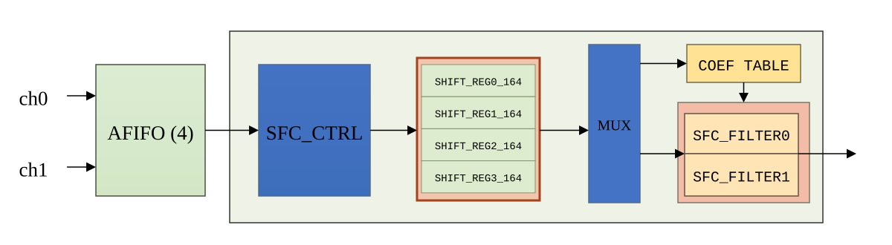
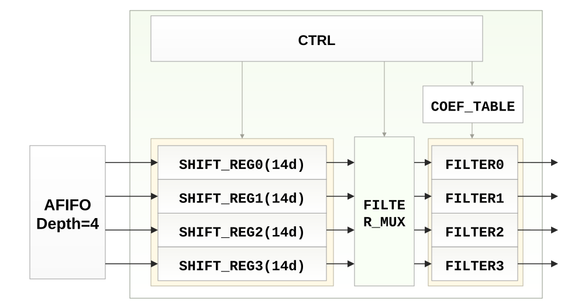

# draw.io 图纸

## SFC

- [sfc.drawio](sfc.drawio)：按参考图重画的可编辑 SFC 框图。
- [sfc.svg](sfc.svg)：从同一份 draw.io 图元导出的矢量预览。

使用 diagrams.net / draw.io 的“文件 → 从设备打开”选择 `sfc.drawio`，或通过 GitHub 存储打开本仓库的 `drawio/sfc.drawio`。模块、文字、分组与箭头均可编辑，预览图不是嵌入 draw.io 的底图。配色和布局沿用参考图。

## SFC 四通道结构

- [sfc_v2.drawio](sfc_v2.drawio)：第二张参考图对应的可编辑框图。
- [sfc_v2.svg](sfc_v2.svg)：同一份图纸的矢量预览。

包含 AFIFO（Depth=4）、四路 SHIFT_REG(14d)、FILTER_MUX、COEF_TABLE、四路 FILTER 和顶部 CTRL。四路数据、控制和系数连接均使用可编辑连接线；FILTER_MUX 的文字分行为 `FILTE` / `R_MUX`，与参考图一致。
