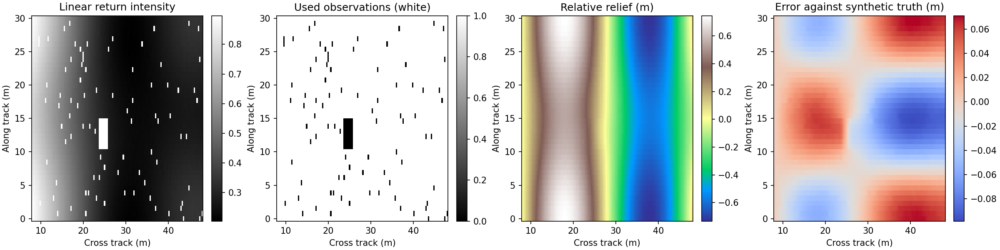
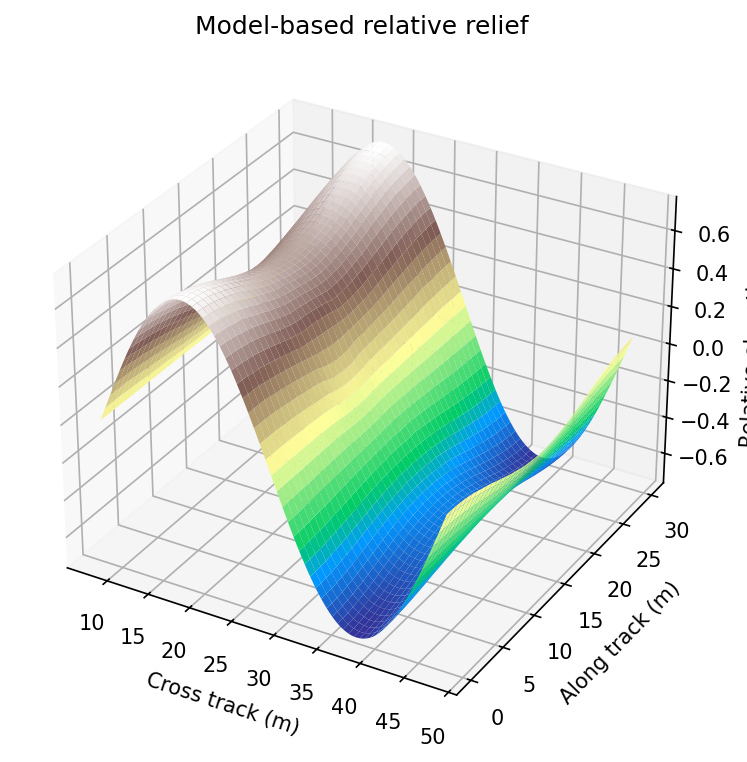

# 侧扫声呐相对地形重建：轻量 CPU 基线

这个目录提供一个不训练神经网络的可运行原型：**线性回波强度 → 横向坡度 → 带平滑约束的相对高程**。适合先验证侧扫声呐的强度地形反演思路，不需要 GPU、模型权重或下载训练集。

侧扫声呐主要测量回波强度，单幅强度图不能唯一确定海底高程。这里输出的是在已知高度、增益、反射率和边界条件下的**模型相对起伏**，不是测深仪测得的绝对水深。真实应用需要测深控制点、导航和辐射校正。

## 关于 SuperiorEE 的 CSDN 资料

需求指定参考 SuperiorEE 的 CSDN 文章。实现时访问 `https://blog.csdn.net/SuperiorEE` 被当前环境的网络策略拒绝（CONNECT 403），因而**没有读到或核验具体文章正文，也没有确定文章标题、链接及其算法**。本实现独立采用下述简化强度反演方法，不冒称复现该作者的方案。后续拿到可访问的文章内容，可对照替换散射模型、标定方式和重建约束。

没有借其他站点代理绕过访问限制；本目录没有复制未核验的文章文字或代码。

## 目录内容

- `reconstruct.py`：输入校验、前向散射近似、坡度反演、稀疏地形求解、命令行和结果导出。
- `evaluate.py`：同模型、噪声、反射率偏差、几何偏差四种合成实验。
- `tests/test_reconstruct.py`：左右舷、非均匀采样、缺测、输入错误和收敛状态验证。
- `examples/`：固定随机种子的输入、真值、重建结果、误差报告和可直接查看的图。

## 快速运行

Python 3.10+，在仓库根目录执行：

```bash
python -m venv sonar_terrain/.venv
source sonar_terrain/.venv/bin/activate
python -m pip install -r sonar_terrain/requirements.txt
python sonar_terrain/reconstruct.py demo --output sonar_terrain/outputs/demo
python sonar_terrain/evaluate.py --output sonar_terrain/outputs/sensitivity.json
python -m unittest discover -s sonar_terrain/tests -v
```

`demo` 使用 40 个 ping × 128 个距离单元，加入强度噪声和少量缺测。运行不需要联网。示例数据完全由公式生成，没有第三方数据许可问题。

已有输入可直接运行：

```bash
python sonar_terrain/reconstruct.py reconstruct sonar_terrain/examples/input.npz \
  --output sonar_terrain/outputs/reconstruction
```

对于只读主目录环境，可在命令前设置 `MPLCONFIGDIR=/tmp/sonar-mpl`，供 Matplotlib 写入字体缓存。

## 输入规范

输入是单个 `.npz` 文件，使用 `numpy.savez_compressed` 生成，数组载入禁用 pickle。

| 键 | 形状 | 含义 |
| --- | --- | --- |
| `intensity` | `(M, N)` | 已完成辐射/距离衰减校正的**线性散射强度（非对数，须与余弦模型匹配）**，与下文前向公式一致；不能直接用 dB、JPEG 灰度或未知自动增益后的显示值 |
| `x` | `(N,)` | 横向地距，单位 m；严格递增，只能全正（右舷）或全负（左舷），不含天底区 |
| `y` | `(M,)` | 航迹方向坐标，单位 m，严格递增 |
| `altitude` | 标量或 `(M,)` | 声呐距参考平面的高度，单位 m，必须大于零 |
| `gain` | 标量或 `(M,)` | 已知的剩余乘性增益，必须大于零 |
| `reflectivity` | 标量或 `(M,)` | 已知等效反射系数，必须大于零；算法假设同一 ping 横向一致 |
| `mask` | 可选 `(M, N)` | `True` 表示候选观测，`False` 表示阴影、坏点、水柱等缺测；程序还会过滤非有限值、饱和值和不满足坡度约束的观测 |
| `anchor` | 可选 `(M,)` | 每个 ping 中最接近天底的采样点高程，单位 m，默认全零；是输入边界条件，不是算法自动测出的深度 |

左右舷应分别运行。左舷输入按 x 递增排列，锚点在该行最后一个采样点。双侧结果只有使用同一真实高程基准时才能拼接，默认各自置零不保证两侧真实相连。

原始侧扫数据常按斜距存储。仅在平坦参考面近似下可用 `|x| = sqrt(r²-h²)` 把斜距 r 转成地距；需要剔除 `r <= h` 的水柱，再重采样到共同地距网格。**当前程序不解析 XTF/JSF，也不自动做斜距校正、TVG 撤销、姿态补偿或导航拼接。** 如果厂家像素是功率或对数显示量，必须先建立其与本模型的强度关系。

## 模型与推导

设参考平面高程为 0，声呐高度为 h，横向坐标为 x，相对高程为 z，横向坡度为 `p = ∂z/∂x`。假定：

1. 地形起伏相对高度较小，射线几何以参考平面代替，即忽略射线方向中的 z。
2. 沿航迹坡度对散射法向的影响较小。
3. 有效散射采用 Lambert 余弦近似，材料反射率可标定；距离衰减、波束图和 TVG 已校正。
4. 没有多次散射或遮挡；阴影必须标为缺测，不能把暗影当成真实坡度。

朝向声呐的单位方向和地形单位法向分别近似为：

$$
\boldsymbol\ell=\frac{(-x,h)}{\sqrt{x^2+h^2}},\qquad
\boldsymbol n=\frac{(-p,1)}{\sqrt{1+p^2}}.
$$

因此标定后的强度满足：

$$
q=\frac{I}{g\rho}
=\boldsymbol n\cdot\boldsymbol\ell
=\frac{h+xp}{\sqrt{x^2+h^2}\sqrt{1+p^2}}.
$$

令 `α = atan2(x,h)`，`θ = atan(p)`，则 `q = cos(α−θ)`。选择与平坦地形连续的分支：

$$
\theta=\alpha-\operatorname{sign}(x)\arccos(q),\qquad p=\tan\theta.
$$

余弦反演存在分支歧义，不能无限制地从强度恢复坡度。程序默认限制 `|p| ≤ 0.35`，并剔除 `|x|/h ≤ 1.05 × max_slope` 的近天底点，使允许坡度区间避开转折点。`q≤0`、`q≥1`、无效标定和过陡坡面也不作为观测。

获得坡度后求解：

$$
\min_z\;\|W(D_xz-\bar p)\|_2^2
+\lambda_x\|\Delta_x D_xz\|_2^2
+\lambda_y\|D_yz\|_2^2,
\qquad z_{i,k}=a_i.
$$

- `D_x`、`D_y` 是使用实际米坐标间距的差分梯度。
- `p̄` 为相邻有效采样点坡度的均值；`W` 仅在两端都有效时为 1。
- `Δ_x` 计算相邻横向坡度之差；该平滑项按网格差分定义，改变采样密度后可能需要重调权重。
- `λ_x` 默认 0.3，抑制横向坡度的快速变化；`λ_y` 默认 0.3，抑制沿航迹条带，但也会压低真实沿航迹变化。
- `a_i` 为输入锚点，`k` 是最靠近天底的横向采样索引。通过消元精确满足锚点，而不是使用大权重近似。

采用 SciPy 稀疏矩阵与 LSQR，不构建像素数平方大小的稠密矩阵。默认迭代上限 1200，输入上限 300000 像素；大区域应分块或降采样。未收敛时输出报告明确标记并以非零状态码退出，结果仅供排查。

## 输出与预览





| 文件 | 内容 |
| --- | --- |
| `reconstruction.npz` | x、y、相对高程、观测坡度、有效观测掩码 |
| `points.csv` | `x_m,y_m,relative_elevation_m,observed`，可导入点云或绘图软件 |
| `overview.png` | 输入、观测掩码、高程；demo 还显示对合成真值的误差 |
| `surface.png` | 三维地形曲面预览 |
| `report.json` | 收敛状态、迭代数、有效比例，demo 另含 RMSE/MAE |

`observed=0` 的区域属于由平滑约束补出的结果，**不是实测高程**；`observed=1` 也仅表示该点强度参与反演，不代表高程已经被测量或给出了置信区间。缺测面积很大时不要使用曲面的平滑外观判断可靠性。

## 结果与局限

固定种子 demo 的合成同模型 RMSE 约 **0.042 m**；真值起伏小于 1 m。这只是前向/反演一致性的检查，不是海试精度。运行时间及峰值内存记录见 `examples/runtime.json`，数值仅代表当前云 CPU 和此小尺寸示例。

另一组固定合成实验（24 × 96）在 `examples/sensitivity.json`：

| 实验 | 相对高程 RMSE |
| --- | --- |
| 同模型、无噪声 | 约 0.011 m |
| 同模型、加入噪声 | 约 0.011 m |
| 横向反射率存在 5% 正弦调制，反演仍假设均匀 | 约 0.385 m |
| 前向考虑实际起伏和沿航迹法向，反演仍采用参考平面 | 约 0.171 m |

这些结果说明材料反射率和几何近似能引入明显偏差，即使求解器已经收敛。其他限制包括：积分累计误差、边界条件不确定性、真实散射非 Lambert、深阴影信息缺失，以及航迹倾斜/姿态变化。绝不能把 `depth = altitude - z` 直接解释为相对海面的绝对水深。

暂不使用深度学习，是因为目前没有配对的“侧扫图像—真实地形”训练/验证数据，也没有已核验的指定文章方法；直接训练小模型同样无法解决不可辨识性。优先得到可解释、可检查的基线，再用测深仪或多波束真值评估。后续如果有配对数据，可以增加小型卷积残差网络修正物理基线，并按独立航次划分数据，避免相邻切片泄漏。
