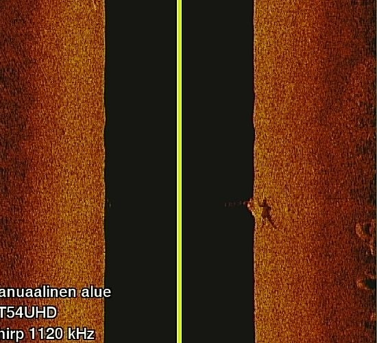

# Garmin 真实侧扫声呐图像小样本

已实际下载 **8 张原始 JPEG 文件**（不是生成的合成图），加上上游许可和说明，共约 **543 KiB**。原文件保持字节不变。

- 数据来源：[tonaalt/sonar_human_dataset](https://github.com/tonaalt/sonar_human_dataset)
- 固定版本：`1099809a296a1c4a62cad3cc3d6edf5639c2e1b9`
- 上游说明：使用 Garmin 消费级侧扫声呐真实采集，分为 human 和 other 类别。
- 对应论文：*Consumer Class Side Scanning Sonar Dataset for Human Detection*，DOI：[10.23919/MIPRO57284.2023.10159954](https://doi.org/10.23919/MIPRO57284.2023.10159954)。来源信息依据随附的上游 README，未独立核验论文全文。
- 许可：上游仓库 MIT License，Copyright (c) 2023 Toni Aaltonen，完整保存在 [LICENSE](LICENSE)。
- 下载日期：2026-11-06。

| 本地文件 | 上游分类 | 分辨率 |
| --- | --- | --- |
| `000206.jpg`、`000220.jpg`、`000240.jpg`、`000260.jpg` | `data/human_test` | 每张 550 × 500 |
| `nohuman000280.jpg` 至 `nohuman000283.jpg` | `data/nohuman_test/cropped/nohuman` | 每张 100 × 70 |

人目标类别不代表每个像素的标签；负样本本身已由上游裁剪。两类图像尺寸和处理方式不同，不能直接当成公平的分类训练集。这里只取少量测试样本供图像查看和预处理试验，没有下载整个数据集。

## 预览



## 核验与重新下载

在仓库根目录执行：

```bash
python sonar_terrain/download_real_data.py --verify-only
python sonar_terrain/download_real_data.py
```

第一条离线核验所有原文件；第二条仅补下载缺失或校验失败的文件。`manifest.json` 包含每个文件的原路径、固定版本下载 URL、字节数、图像尺寸和 SHA-256。`UPSTREAM_README.md` 为上游原始说明。

## 能否用于地形重建

这是**真实声呐图像数据**，不是 XTF/JSF 原始 ping，也没有下载到配套的逐 ping 高度、航迹米坐标、辐射标定或海底高程真值。

因此可以用于图像显示、去噪、纹理、阴影分析；**不能直接把 JPEG 灰度作为线性散射强度，输入当前重建器并宣称得到以米为单位的真实地形**。本次没有伪造高度/增益，也没有把真实图像包装成标定 NPZ。要做有物理尺度的重建，下一步需要带高度、导航和校正信息的原始侧扫测线，最好另有多波束或测深控制数据。
