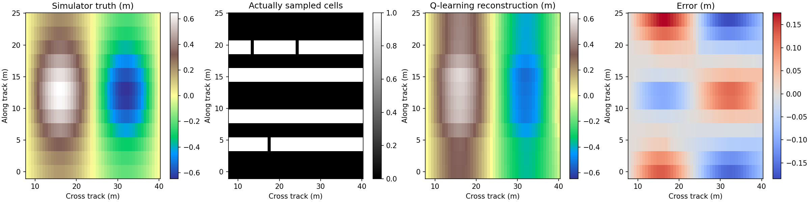
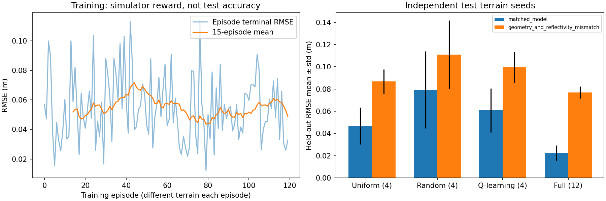

# 模拟采集、地形重建与轻量强化学习

这里实现完整闭环：**生成带真值的地形 → 模拟声呐回波 → 策略选择采样位置 → 调用现有物理重建器 → 用真值计算误差和奖励 → 更新采样策略**。

采用 NumPy 表格 Q-learning，无神经网络、无 GPU、无新训练依赖。Q 表是 `4096 × 12` 个 float32，未压缩约 192 KiB。默认完整实验约 19 秒（当前云 CPU；包含画图），而不是训练大模型。

## 已生成的结果





以下为 **12 个未参与训练的地形**上的 RMSE 均值，单位 m：

| 采样策略 | 每场景采样次数 | 同散射模型，含噪声与缺测 | 几何与反射率存在偏差 |
| --- | --- | --- | --- |
| 均匀采样 | 4 | 0.04677 | 0.08672 |
| 随机采样 | 4 | 0.07942 | 0.11103 |
| Q-learning | 4 | 0.06082 | 0.09954 |
| 全部采样 | 12 | 0.02221 | 0.07702 |

**本次 Q-learning 优于随机，但没有超过均匀采样。** 120 个训练场景、有限的覆盖状态和简单的地形分布，并未显示强化学习优于规则策略。保留负面比较结果，不用测试集继续挑选训练参数。全采样用三倍预算，仅作为数据充分时的参考，不能当作等成本竞争方法。

各场景的 RMSE、均值、标准差，以及 MAE、逐场景最大绝对误差的均值均记录在 `results/metrics.json`。误差覆盖整个模型网格，包含未采样区域；不是只评价观测点。图中误差棒为不同地形之间的标准差，不是置信区间。这里只运行一个训练随机种子、12 个测试地形，不能据此给出统计显著性结论。

## 运行方法

在仓库根目录执行，依赖与原重建器相同：

```bash
python -m pip install -r sonar_terrain/requirements.txt
python sonar_terrain/simulation/experiment.py \
  --output sonar_terrain/outputs/simulation \
  --episodes 120 --test-count 12
python -m unittest discover -s sonar_terrain/tests -v
```

在只读主目录环境，可在实验命令前加 `MPLCONFIGDIR=/tmp/sonar-mpl`。所有训练/测试数据由本地模拟器生成，不需要联网下载。默认测试命令会跳过缺少可选 `pyxtf` 时的原始文件测试，模拟测试不依赖 pyxtf。

## 模拟采集环境

- 网格：12 个沿航迹位置 × 48 个横向距离单元，x 为 8～40 m，y 为 0～24 m。
- 场景：横向正弦起伏乘以沿航迹包络；不同随机种子改变振幅、包络中心、宽度和相位。近天底边界始终为零，与重建器的默认锚点一致。
- 元数据：已知模拟高度和增益；这些不是由强度自动估出来的。
- 观测：余弦散射模型、标准差 0.0015 的强度噪声、约 1% 缺测。
- 每个动作选择一个尚未测量的沿航迹位置，返回该行的 48 个强度采样。
- 未采样单元在观测中为 NaN，掩码为 False；策略不能直接看到完整回波或地形真值。
- 每次采集之后，用 `reconstruct.py` 中同一个稀疏重建器重建整个地形。

模拟器是小型、准静态的**采样位置选择环境**，没有船体动力学、航速/转弯约束、采集时间、多路径、完整传播模型或声学射线追踪。允许跳跃选择位置；每个动作固定成本，不计算航行距离，因此这里不能解释成可部署的最优测线规划。

## 强化学习的定义

**状态**：已采集位置的 12 位覆盖掩码，最多 4096 种。观测接口另返回已采集强度、有效掩码和剩余预算；当前 Q 表刻意只使用覆盖状态，所以学到的是采样顺序/布局，**不是根据回波自适应的复杂策略**。

**动作**：选择 0～11 中的一个未采集位置，已采集位置从候选动作中屏蔽。重复动作或预算耗尽后的动作会报错。

**奖励**：

$$
r_t=\operatorname{RMSE}(\hat z_{t-1},z^*)-
\operatorname{RMSE}(\hat z_t,z^*)-0.001.
$$

每个 episode 采集 4 次。折扣因子为 1，所以累计奖励等于“初始 RMSE 减去最终 RMSE，再减去总采集成本”。开始时使用全零地形作为未观测基线。

更新方式：

$$
Q(s_t,a_t)\leftarrow Q(s_t,a_t)+0.3\bigl[
 r_t+\max_{a\ \mathrm{未采集}}Q(s_{t+1},a)-Q(s_t,a_t)\bigr].
$$

终止状态的未来价值为 0。训练采用 ε-greedy，ε 从 0.8 线性降至 0.1；测试 ε=0，只在并列最佳动作时随机打破平局。环境由隐藏地形决定，覆盖状态不包含完整环境，因此该简单表示不保证满足完整可观测的 Markov 假设，不承诺最优性或收敛。

模拟真值仅供训练奖励和离线误差评估使用，策略输入没有 RMSE 或真值。真实声呐通常无法在线获得这种奖励；若要应用到实测，必须解决仿真到真实的迁移及奖励代理问题。

## 防止把合成精度当作真实精度

- 训练地形种子：1000～1119；测试地形种子：10000～10011，互不重叠。
- 三种同成本策略在测试时使用相同场景、相同回波噪声和相同缺测。
- 训练只用参考平面余弦模型。
- 第二种测试故意让前向过程采用真实起伏后的射线方向、沿航迹法向，以及未知的 3% 横向反射率调制；反演仍使用原近似模型。
- 两种测试都是**模拟实验**。模型不匹配测试也不能替代海试或配对多波束真值。
- 相对高程以已知的模拟零边界为基准；没有恢复海平面绝对水深。

## 输出文件

| 文件 | 内容 |
| --- | --- |
| `policy.npz` | 训练得到的 Q 表 |
| `metrics.json` | 独立测试的全部误差与实验配置 |
| `training.json` | 各训练场景的初始/最终 RMSE 和累计奖励 |
| `example_traces.json` | 每种方法在首个测试地形中的动作、逐步误差和奖励 |
| `example.npz` | 首个测试场景的真值、实际采样、重建及元数据 |
| `reconstruction.png` | 真值、采集掩码、Q-learning 重建、误差图 |
| `evaluation.png` | 训练过程和测试对比 |

下一步若要改善策略，应先扩大训练分布并加入可由实际回波提取的状态特征，再使用新的独立测试集评价，不能仅增加模型大小或反复调同一批测试结果。
